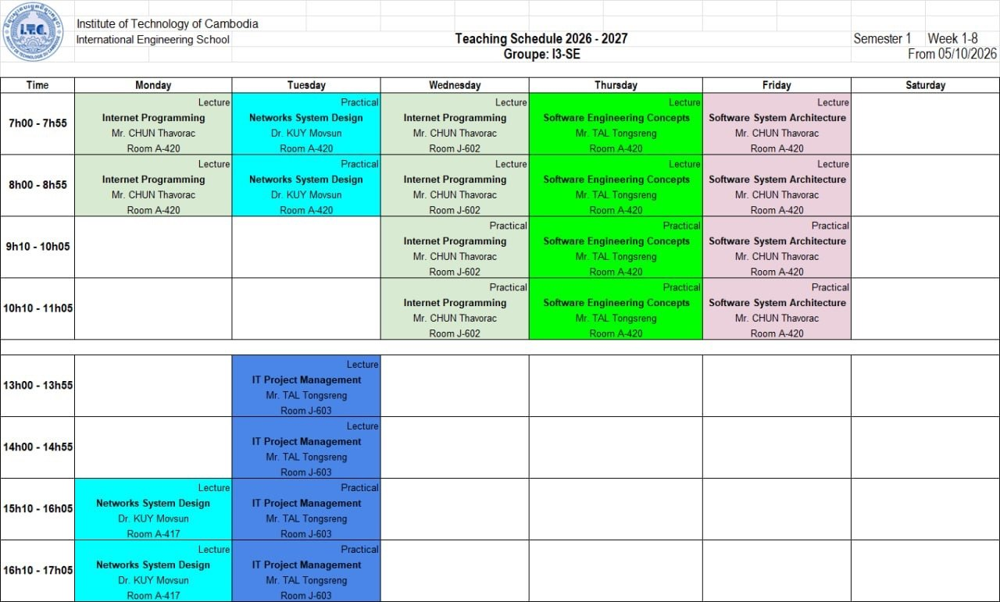
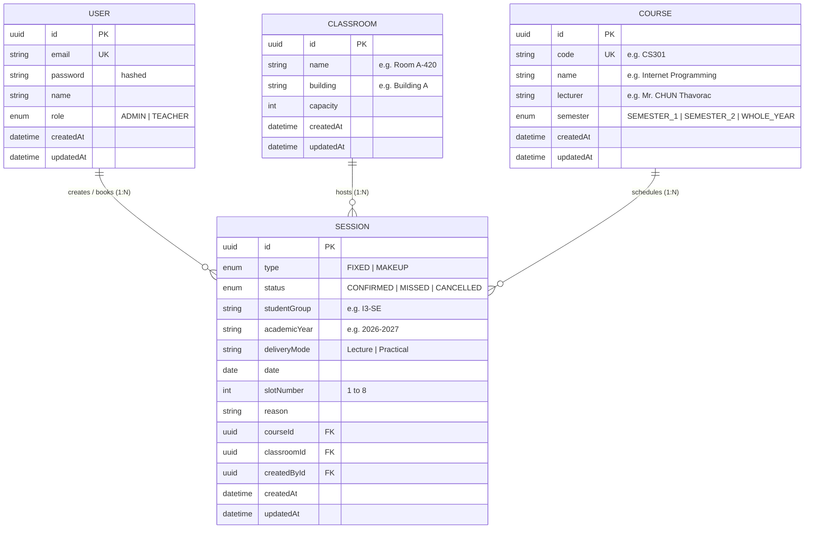
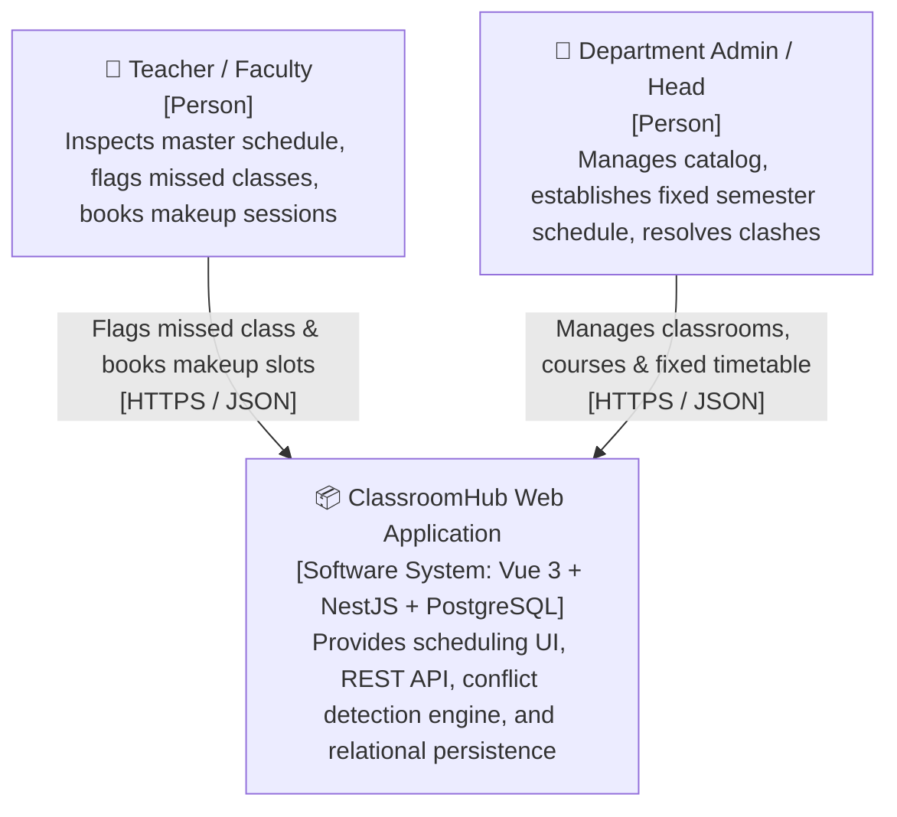
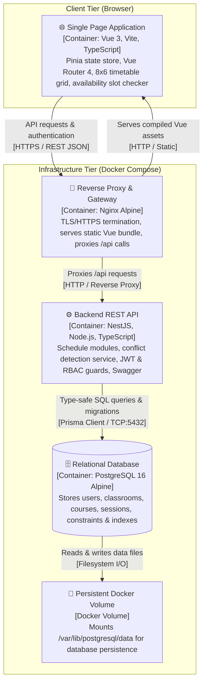

# ClassroomHub — Classroom & Makeup Session Scheduling System

> **Course:** Internet Programming
> **Instructor:** Chun Thavorac
> **Student Author:** Chea Seavhong
> **Version:** 1.0
> **Date:** October 2026
> **Repository:** `https://github.com/flourbloom/classroom-scheduler`

---

## Problem

Academic department heads and university teachers face severe scheduling friction, classroom double-booking, and coordination confusion when managing semester timetables and unavoidable makeup classes caused by faculty absences or schedule adjustments. Without an automated, conflict-aware scheduling platform, rescheduling sessions relies on disjointed manual communication, leading to room clashes, wasted lecture hours, and compromised teaching continuity.

---

## Users and roles

- **Admin (Head of Department / Academic Coordinator):**
  - Manages the institutional catalog of classrooms and courses
  - sets up the initial fixed semester master schedule for each student group across the 8 standardized daily periods,and possesses global administrative oversight to modify, resolve, or reassign any scheduled session.
- **Teacher (Faculty Instructor):**
  - Views the master semester schedule for any student group or classroom
  - flags their own upcoming regular classes as missed when unavailable
  - checks real-time classroom slot availability across campus
  - books/manages makeup sessions directly



---

## User stories

1. **As a Teacher**, I want to search for available classrooms by specifying a date and a time slot number (Slot 1–8), so that I can quickly find an unoccupied room for a makeup session.

   - *Accepted when:* The search query accepts `date` and `slotNumber` (1 to 8).
   - *Accepted when:* The response returns only classrooms that have no active session (`status = CONFIRMED`) on that date and slot.
   - *Accepted when:* Invalid slot numbers (outside 1–8) or past dates return HTTP `400 Bad Request`.
2. **As a Teacher**, I want to flag one of my scheduled classes as "Missed", have its classroom slot immediately released, and have the class card drop into a pending makeup queue at the bottom of the page, so that I can track my missed classes and reschedule them into an open slot this week or search for an available room on a future date.

   - *Accepted when:* Clicking a scheduled class card flips it to reveal a "Flag as Missed" confirmation action; confirming updates the session to `status = MISSED`, immediately releasing that classroom slot for other teachers on that specific date.
   - *Accepted when:* Flagged missed classes animate and drop into a visible "Pending Missed Classes" tray at the bottom of the page, displaying the count of missed sessions needing makeup.
   - *Accepted when:* A missed class card in the bottom tray can be flipped to choose between two rescheduling paths:
     1. **This Week:** Selecting an empty slot directly on the weekly timetable grid to place the makeup class.
     2. **Future Date:** Searching by date and slot number to find an available classroom beyond the current week.
   - *Accepted when:* The makeup booking payload validates `courseId`, `classroomId`, `studentGroup`, `date`, `slotNumber`, and a makeup `reason`.
   - *Accepted when:* The backend performs an atomic check verifying that neither the target classroom nor the student group has another confirmed session on that date and slot; conflicts return HTTP `409 Conflict`.
   - *Accepted when:* On successful booking, the session is created with `type = MAKEUP`, `status = CONFIRMED`, linked to the teacher's `userId`, returns HTTP `201 Created`, and removes the item from the pending missed queue.
3. **As an Admin**, I want to establish the initial fixed semester schedule for student groups (e.g., Groupe I3-SE, Semester 1) across the 8 standardized daily time slots, so that the department has a structured, conflict-free master timetable for the semester.

   - *Accepted when:* The Admin can create fixed sessions (`type = FIXED`) linking course, classroom, student group, delivery mode (`Lecture` or `Practical`), date, and `slotNumber`.
   - *Accepted when:* The system rejects any session that collides with an already scheduled classroom or student group with HTTP `409 Conflict`.
   - *Accepted when:* Endpoints to create or edit fixed semester sessions are protected by role guards; non-admin users attempting access receive HTTP `403 Forbidden`.
4. **As an Admin**, I want to create, update, and manage classrooms (name, building, capacity) and courses (code, name, lecturer), so that the system catalog accurately reflects the institution's facilities and curriculum.

   - *Accepted when:* Classrooms cannot have duplicate room names within the same building.
   - *Accepted when:* Deleting a classroom or course with active future sessions is safely blocked with referential integrity.
5. **As a Teacher or Admin**, I want to view the timetable formatted as an 8-period by 6-day (Monday–Saturday) interactive grid filtered by student group or classroom, with container/card-style class sessions showing subject, teacher name, room, and delivery mode, so that I can easily inspect academic commitments matching the schedule format.

   - *Accepted when:* Grid cells render each class session in a card view displaying course name, lecturer, classroom, and delivery mode badge (`Lecture` or `Practical`), with distinct color accents per course matching the schedule layout.
   - *Accepted when:* The grid renders each period with its standardized time label (e.g., Slot 1: 07h00–07h55) across the active week.
   - *Accepted when:* Clicking an active class card flips the card (3D flip effect) to reveal details and actions (such as flagging as missed for teachers).
   - *Accepted when:* Missed classes, fixed classes, and makeup classes are visually distinguished.
6. **As a Teacher**, I want to edit or cancel a makeup session that I previously booked, so that unneeded rooms are promptly released if makeup plans change.

   - *Accepted when:* Ownership is strictly enforced; a teacher cannot edit or cancel makeup sessions scheduled by another teacher (returns HTTP `403 Forbidden`).
   - *Accepted when:* An Admin has override authority to cancel or reschedule any session for emergency room management.
   - *Accepted when:* Cancellation updates the session status to `CANCELLED`, immediately reopening the slot for availability queries.
7. **As a prospective or registered user**, I want to sign up and log in securely with my email and password, so that I receive a signed JWT token authorizing my actions based on my role (`ADMIN` or `TEACHER`).

   - *Accepted when:* Passwords are encrypted with `bcrypt` (work factor $\ge 10$) or `argon2` before persistence.
   - *Accepted when:* Valid credentials return a signed JWT payload containing `userId` and `role`; invalid credentials return HTTP `401 Unauthorized`.
8. **As a Teacher or Admin (Stretch Feature)**, I want to filter, search, and paginate through scheduled sessions and room availability by building, capacity, and date, so that large semester datasets are navigable without client performance lag.

   - *Accepted when:* Querying `/sessions?page=1&limit=10&studentGroup=I3-SE&type=MAKEUP` returns paginated items alongside total count and page metadata.
   - *Accepted when:* Room availability search supports dynamic filters for building and capacity thresholds with paginated results.

---

## MVP scope

- **Must have:**
  - **Story 1:** Classroom availability lookup by date and slot number (1–8).
  - **Story 2:** Interactive card flip to flag missed classes, drop into bottom makeup queue, and reschedule (within the week or via future date/slot search).
  - **Story 3:** Admin creation of fixed semester schedules across the 8 daily slots.
  - **Story 4:** Admin CRUD management for classrooms and courses.
  - **Story 5:** Interactive 8 $\times$ 6 weekly timetable grid with flippable class cards matching the schedule layout.
  - **Story 6:** Ownership-guarded editing and cancellation of makeup sessions.
  - **Story 7:** User authentication (registration, login, password hashing, JWT guards, role checks).
- **Nice to have:**
  - **Story 8 (Stretch Feature):** Multi-criteria search, filtering, and pagination for sessions and room availability.
  - Exporting schedule data to PDF for student and faculty.
  - Email/push notification dispatches when an admin overrides or moves a scheduled class.

---

## Entities

### Entity Table

| Entity              | Main attributes                                                                                                                                                                                                                                                                                                                                                                           | Relations                                                                      |
| ------------------- | ----------------------------------------------------------------------------------------------------------------------------------------------------------------------------------------------------------------------------------------------------------------------------------------------------------------------------------------------------------------------------------------- | ------------------------------------------------------------------------------ |
| **User**      | `id` (UUID), `name`, `email`, `password` (hashed), `role` (`ADMIN` \| `TEACHER`), `createdAt`, `updatedAt`                                                                                                                                                                                                                                                              | Has many `Session` records (as creator)                                      |
| **Classroom** | `id` (UUID), `name` (e.g., "Room A-420", "Room J-602"), `building` (e.g., "Building A"), `capacity` (Int), `createdAt`, `updatedAt`                                                                                                                                                                                                                                           | Has many `Session` records                                                   |
| **Course**    | `id` (UUID), `code` (e.g., "CS301"), `name` (e.g., "Internet Programming"), `lecturer` (e.g., "Mr. CHUN Thavorac"), `semester` (`SEMESTER_1` \| `SEMESTER_2` \| `WHOLE_YEAR`), `createdAt`, `updatedAt`                                                                                                                                                               | Has many `Session` records                                                   |
| **Session**   | `id` (UUID), `type` (`FIXED` \| `MAKEUP`), `status` (`CONFIRMED` \| `MISSED` \| `CANCELLED`), `studentGroup` (e.g., "I3-SE"), `academicYear` (e.g., "2026-2027"), `deliveryMode` ("Lecture" \| "Practical"), `date` (Date), `slotNumber` (Int: 1..8), `reason` (Text, optional), `courseId`, `classroomId`, `createdById`, `createdAt`, `updatedAt` | Belongs to `Course`, belongs to `Classroom`, belongs to `User` (creator) |

### Entity-Relationship Model (ERM / ERD)



---

## Stretch feature

**Chosen feature:** **Search, filter and pagination**

**What it does in this app:**

1. **Dynamic Classroom Availability Search Engine:** Teachers and administrators can search for open classrooms across campus by selecting a target date, slot number (1–8), minimum capacity, and optional building name. The backend executes a fast query filtering out any classroom occupied by an active session (`status = CONFIRMED`) during that slot, displaying results 10 per page with pagination controls.
2. **Paginated Master & Makeup Schedule Explorer:** A unified schedule directory where users can search sessions by course code, course name, lecturer, student group, or date range, toggle filters between fixed semester classes and makeup classes, and page through hundreds of semester sessions with pagination controls (`page`, `limit`, total pages).

---

## Repository

`https://github.com/flourbloom/classroom-scheduler`

---

## Appendix & Technical Design Specification

### A. Standardized Daily Time Slot Matrix

Rather than storing redundant start and end time strings in the database, the system normalizes time into fixed daily slot periods matching the official timetable:

|   Slot Number   | Time Interval |   Period Label   | Session Shift |
| :--------------: | :------------: | :---------------: | :-----------: |
| **Slot 1** | 07:00 – 07:55 |  `7h00 - 7h55`  |    Morning    |
| **Slot 2** | 08:00 – 08:55 |  `8h00 - 8h55`  |    Morning    |
| **Slot 3** | 09:10 – 10:05 | `9h10 - 10h05` |    Morning    |
| **Slot 4** | 10:10 – 11:05 | `10h10 - 11h05` |    Morning    |
| **Slot 5** | 13:00 – 13:55 | `13h00 - 13h55` |   Afternoon   |
| **Slot 6** | 14:00 – 14:55 | `14h00 - 14h55` |   Afternoon   |
| **Slot 7** | 15:10 – 16:05 | `15h10 - 16h05` |   Afternoon   |
| **Slot 8** | 16:10 – 17:05 | `16h10 - 17h05` |   Afternoon   |

---

### B. Core Business Rules & Conflict Detection Algorithm

1. **Classroom Non-Overlap Invariant (Database Level):**
   No two confirmed sessions can occupy the same classroom at the same date and slot:

   $$
   \forall S_1, S_2 \in \text{Sessions}, \; (S_1.\text{classroomId} = S_2.\text{classroomId} \;\land\; S_1.\text{date} = S_2.\text{date} \;\land\; S_1.\text{slotNumber} = S_2.\text{slotNumber} \;\land\; S_1.\text{status} = \text{CONFIRMED} \;\land\; S_2.\text{status} = \text{CONFIRMED}) \implies S_1.\text{id} = S_2.\text{id}
   $$

   Enforced at the database engine level via PostgreSQL unique index:

   ```prisma
   @@unique([classroomId, date, slotNumber])
   ```
2. **Student Group Non-Overlap Invariant (Service Level):**
   A student group (e.g., "I3-SE") cannot attend two simultaneous classes. The backend verifies:

   $$
   \text{COUNT}(\text{Sessions where } \text{studentGroup} = G \;\land\; \text{date} = D \;\land\; \text{slotNumber} = S \;\land\; \text{status} = \text{CONFIRMED}) = 0
   $$

   Violations return HTTP `409 Conflict`.
3. **Missed Class Release Rule:**
   When a teacher flags a session as `status = MISSED`, its active occupancy on that `(classroomId, date, slotNumber)` is released, immediately making that classroom available for another teacher's makeup session.
4. **Role & Ownership Enforcement:**

   - `ADMIN`: Global permissions to create, update, or cancel any session (`FIXED` or `MAKEUP`).
   - `TEACHER`: Can flag their own scheduled class as `MISSED`; can create `MAKEUP` sessions; can only update or cancel makeup sessions where `session.createdById == currentUser.id`.

---

### C. Relational Data Model (Prisma Schema)

```prisma
// prisma/schema.prisma

datasource db {
  provider = "postgresql"
  url      = env("DATABASE_URL")
}

generator client {
  provider = "prisma-client-js"
}

enum Role {
  ADMIN
  TEACHER
}

enum SessionType {
  FIXED
  MAKEUP
}

enum SessionStatus {
  CONFIRMED
  MISSED
  CANCELLED
}

enum Semester {
  SEMESTER_1
  SEMESTER_2
  WHOLE_YEAR
}

model User {
  id        String    @id @default(uuid())
  email     String    @unique
  password  String    // Hashed with bcrypt or argon2
  name      String
  role      Role      @default(TEACHER)
  createdAt DateTime  @default(now())
  updatedAt DateTime  @updatedAt

  // 1:N Relation: User -> Sessions (Makeup bookings or scheduled by user)
  sessions  Session[]

  @@map("users")
}

model Classroom {
  id        String    @id @default(uuid())
  name      String    // e.g. "Room A-420", "Room J-602"
  building  String    // e.g. "Building A", "Building J"
  capacity  Int
  createdAt DateTime  @default(now())
  updatedAt DateTime  @updatedAt

  // 1:N Relation: Classroom -> Sessions
  sessions  Session[]

  @@unique([name, building])
  @@map("classrooms")
}

model Course {
  id        String    @id @default(uuid())
  code      String    @unique // e.g. "CS301"
  name      String    // e.g. "Internet Programming"
  lecturer  String    // e.g. "Mr. CHUN Thavorac"
  semester  Semester  @default(SEMESTER_1)
  createdAt DateTime  @default(now())
  updatedAt DateTime  @updatedAt

  // 1:N Relation: Course -> Sessions
  sessions  Session[]

  @@map("courses")
}

model Session {
  id           String        @id @default(uuid())
  type         SessionType   @default(FIXED)
  status       SessionStatus @default(CONFIRMED)
  
  // Academic Context
  studentGroup String        // e.g. "I3-SE"
  academicYear String        // e.g. "2026-2027"
  deliveryMode String        // "Lecture" | "Practical"
  
  // Schedule Timing 
  date         DateTime      @db.Date
  slotNumber   Int           // 1 to 8
  reason       String?       // Reason for missed class or makeup booking

  // Foreign key to Course
  courseId     String
  course       Course        @relation(fields: [courseId], references: [id], onDelete: Restrict)

  // Foreign key to Classroom
  classroomId  String
  classroom    Classroom     @relation(fields: [classroomId], references: [id], onDelete: Restrict)

  // Foreign key to User (Creator)
  createdById  String
  createdBy    User          @relation(fields: [createdById], references: [id], onDelete: Restrict)

  createdAt    DateTime      @default(now())
  updatedAt    DateTime      @updatedAt

  // Double-booking prevention & performance indexes
  @@unique([classroomId, date, slotNumber])
  @@index([studentGroup, date, slotNumber])
  @@index([date, slotNumber])
  @@map("sessions")
}
```

---

### D. System Architecture (C4 Model)

#### C4 Level 1: System Context Diagram



#### C4 Level 2: Containers Diagram



---

### E. Architectural Decision Record (ADR-001)

- **Title:** ADR-001: Normalized Slot-Based Modular Monolith with Prisma ORM
- **Status:** **Accepted**
- **Context:** The system requires atomic conflict detection across classrooms and student groups during fixed schedule generation and makeup class booking. Rather than storing arbitrary, redundant start/end time strings, the academic timetable operates on 8 discrete periods per day.
- **Decision:** Build a modular monolith in **NestJS** with **Prisma ORM** over **PostgreSQL**. Normalize session times into discrete slot numbers (`1..8`), enforcing room conflict prevention via an atomic database compound unique index (`[classroomId, date, slotNumber]`).
- **Consequences:**
  - *Positive:* Eliminates redundant time strings; converts complex overlap math into instant $O(1)$ index lookups; avoids database corruption with native PostgreSQL unique constraints; simplifies frontend 8 $\times$ 6 grid rendering.
  - *Negative:* Non-standard period lengths outside the 8 fixed slots would require schema modification; acceptable because we strictly adhere to the 8 standard periods.

---

### F. Capacity Estimation & Back-of-the-Envelope Calculations

- **Institutional Scale:**
  - 100 Classrooms across campus.
  - 500 Courses per semester.
  - 2,000 Active sessions per week (~20,000 sessions/semester).
  - 300 Teachers & department staff members.
- **Throughput & QPS:**
  - Average weekday queries: $\approx 15,000$ requests/day.
  - Average QPS: $\frac{15,000}{86,400} \approx 0.17\text{ QPS}$.
  - Peak QPS ($5\times$ peak multiplier): $\approx 0.85\text{ QPS}$ (well below single-node NestJS capacity of 1,000+ QPS).
- **Storage Footprint:**
  - Session record size: $\approx 250\text{ bytes}$ (further reduced by replacing time strings with integer slot indices).
  - Annual session storage: $20,000 \times 2\text{ semesters} \times 250\text{ B} \approx 10\text{ MB / year}$.
  - Over 5 years, the entire dataset requires $< 100\text{ MB}$, fitting comfortably inside minimal container storage./

---

### G. Milestone M0 Design Reflection

> We did not include **Google/Outlook Calendar sync** and **automated reschedule suggestions** .
>
> **Why?**
>
> * **Reduces external risks:** Third-party APIs and OAuth flows can fail or require internet access during a live evaluation.
> * **Focuses on core value:** It let us focus 100% on what matters most: reliable room availability search, role permissions, and zero double-booking (for rooms and student groups).
