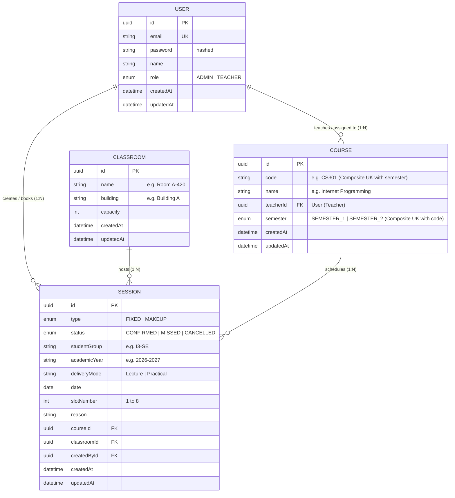
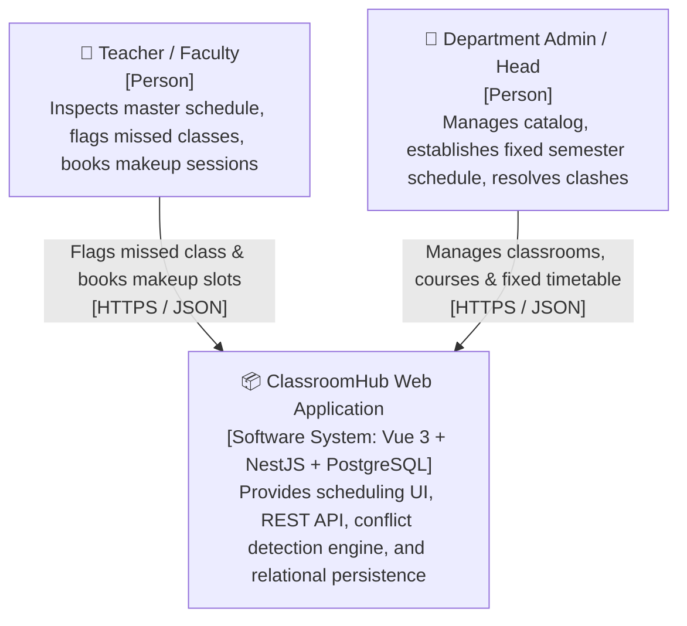
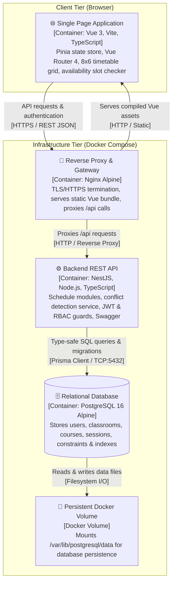

# ClassroomHub — Classroom & Makeup Session Scheduling System

> **Course:** Internet Programming
> **Instructor:** Chun Thavorac
> **Student Author:** Chea Seavhong
> **Version:** 1.0
> **Date:** October 2026
> **Repository:** `https://github.com/flourbloom/classroom-scheduler`

---

## Problem

Academic department heads and university teachers face severe scheduling friction, classroom double-booking, and coordination confusion when managing semester timetables and unavoidable makeup classes caused by faculty absences or schedule adjustments. Without an automated, conflict-aware scheduling platform, rescheduling sessions relies on disjointed manual communication, leading to room clashes, wasted lecture hours, and compromised teaching continuity.

---

## Users and roles

- **Admin (Head of Department / Academic Coordinator):**
  - Creates and provisions **Teacher accounts** (name, institutional email, initial password) and manages user roles
  - Manages the institutional catalog of classrooms and courses, assigning each course to its designated faculty teacher
  - Sets up the initial fixed semester master schedule for each student group across the 8 standardized daily periods
  - Possesses global administrative oversight to modify, resolve, or reassign any scheduled session across the department
- **Teacher (Faculty Instructor):**
  - Authenticates securely using admin-provisioned email and password credentials
  - Views the master semester schedule for any student group/classroom and accesses a personalized "My Teaching Schedule" & "My Courses" view
  - Flags their own upcoming regular classes as missed when unavailable (strictly isolated: cannot edit, flag, or alter classes taught by other instructors)
  - Checks real-time classroom slot availability across campus
  - Books and manages makeup sessions for their missed classes


---

## User stories

1. **As a Teacher**, I want to search for available classrooms by specifying a date and a time slot number (Slot 1–8), so that I can quickly find an unoccupied room for a makeup session.

   - *Accepted when:* The search query accepts `date` and `slotNumber` (1 to 8).
   - *Accepted when:* The response returns only classrooms that have no active session (`status = CONFIRMED`) on that date and slot.
   - *Accepted when:* Invalid slot numbers (outside 1–8) or past dates return HTTP `400 Bad Request`.
2. **As a Teacher**, I want to flag one of my scheduled classes as "Missed", have its classroom slot immediately released, and have the class card drop into a pending makeup queue at the bottom of the page, so that I can track my missed classes and reschedule them into an open slot this week or search for an available room on a future date.

   - *Accepted when:* Clicking a scheduled class card opens the session action controls/modal to reveal a "Flag as Missed" confirmation action; confirming updates the session to `status = MISSED`, immediately releasing that classroom slot for other teachers on that specific date. *(Core functional modal/button state transitions are built first; 3D card flip transitions and drag-to-tray physics are progressive visual polish added after core stories work).*
   - *Accepted when:* **Ownership isolation:** A teacher can only flag sessions for courses assigned to them (`session.course.teacherId == currentUser.id`); attempts to flag or modify another teacher's class return HTTP `403 Forbidden`.
   - *Accepted when:* Flagged missed classes drop into a visible "Pending Missed Classes" tray at the bottom of the page, displaying the count of missed sessions needing makeup (motion animation kept as polish after functional queue updates).
   - *Accepted when:* A missed class card in the bottom tray can be selected to choose between two rescheduling paths:
     1. **This Week:** Selecting an empty slot directly on the weekly timetable grid to place the makeup class.
     2. **Future Date:** Searching by date and slot number to find an available classroom beyond the current week.
   - *Accepted when:* The makeup booking payload validates `courseId`, `classroomId`, `studentGroup`, `date`, `slotNumber`, and a makeup `reason`.
   - *Accepted when:* The backend performs an atomic check verifying that neither the target classroom nor the student group has another confirmed session on that date and slot; conflicts return HTTP `409 Conflict`.
   - *Accepted when:* On successful booking, the session is created with `type = MAKEUP`, `status = CONFIRMED`, linked to the teacher's `userId`, returns HTTP `201 Created`, and removes the item from the pending missed queue.
3. **As an Admin**, I want to establish the initial fixed semester schedule for student groups (e.g., Groupe I3-SE, Semester 1) across the 8 standardized daily time slots, so that the department has a structured, conflict-free master timetable for the semester.

   - *Accepted when:* The Admin can create fixed sessions (`type = FIXED`) linking course, classroom, student group, delivery mode (`Lecture` or `Practical`), date, and `slotNumber`.
   - *Accepted when:* The system rejects any session that collides with an already scheduled classroom or student group with HTTP `409 Conflict`.
   - *Accepted when:* Endpoints to create or edit fixed semester sessions are protected by role guards; non-admin users attempting access receive HTTP `403 Forbidden`.
4. **As an Admin**, I want to create and manage Teacher accounts (with name, institutional email, and password) and manage classrooms and courses (linking each course to its designated teacher), so that the faculty roster and curriculum catalog are fully configured.

   - *Accepted when:* Admin can provision new teacher accounts (`role = TEACHER`, email, hashed password); duplicate emails return HTTP `409 Conflict`.
   - *Accepted when:* Courses are assigned to a valid registered teacher (`teacherId`), establishing the faculty ownership relation.
   - *Accepted when:* Classrooms cannot have duplicate room names within the same building.
   - *Accepted when:* Courses enforce a composite unique key on `(code, semester)` (`@@unique([code, semester])`), preventing duplicate course codes in the same semester while permitting the same course in different semesters.
   - *Accepted when:* Deleting a classroom, course, or teacher with active scheduled sessions is safely blocked with referential integrity.
5. **As a Teacher or Admin**, I want to view the timetable formatted as an 8-period by 6-day (Monday–Saturday) interactive grid filtered by student group, classroom, or personal faculty schedule, with container/card-style class sessions showing subject, teacher name, room, and delivery mode, so that I can easily inspect academic commitments.

   - *Accepted when:* Grid cells render each class session in a card view displaying course name, teacher name, classroom, and delivery mode badge (`Lecture` or `Practical`), with distinct color accents per course matching the schedule layout.
   - *Accepted when:* Teachers can toggle a "My Schedule" filter to isolate sessions for courses they personally teach.
   - *Accepted when:* The grid renders each period with its standardized time label (e.g., Slot 1: 07h00–07h55) across the active week.
   - *Accepted when:* Clicking an active class card opens details and contextual action controls (with 3D card flip animation kept as polish after the stories work); action buttons ("Flag as Missed", "Reschedule") are strictly enabled only for the logged-in teacher's own sessions.
   - *Accepted when:* Missed classes, fixed classes, and makeup classes are visually distinguished.
6. **As a Teacher**, I want to edit or cancel a makeup session that I previously booked, so that unneeded rooms are promptly released if makeup plans change.

   - *Accepted when:* Ownership is strictly enforced; a teacher cannot edit or cancel sessions scheduled by or assigned to another teacher (returns HTTP `403 Forbidden`).
   - *Accepted when:* An Admin has override authority to cancel or reschedule any session for emergency room management.
   - *Accepted when:* Cancellation updates the session status to `CANCELLED`, immediately reopening the slot for availability queries.
7. **As a Teacher or Admin**, I want to log in securely with my email and password (using admin-provisioned or admin credentials), so that I receive a signed JWT token authorizing my actions based on my role (`ADMIN` or `TEACHER`) and scoping my editing privileges strictly to my own sessions.

   - *Accepted when:* Passwords are encrypted with `bcrypt` (work factor $\ge 10$) or `argon2` before persistence.
   - *Accepted when:* Valid credentials return a signed JWT payload containing `userId`, `name`, and `role`; invalid credentials return HTTP `401 Unauthorized`.
   - *Accepted when:* Logged-in teachers have full visibility over timetables, but editing mutations are strictly locked to their own sessions.
8. **As a Teacher or Admin (Chosen Stretch Feature — Mandatory for M4)**, I want to filter, search, and paginate through scheduled sessions and room availability by building, capacity, and date, so that large semester datasets are navigable without client performance lag.

   - *Accepted when:* Querying `/sessions?page=1&limit=10&studentGroup=I3-SE&type=MAKEUP` returns paginated items alongside total count and page metadata.
   - *Accepted when:* Room availability search supports dynamic filters for building and capacity thresholds with paginated results.

---

## MVP scope

- **Must have:**
  - **Story 1:** Classroom availability lookup by date and slot number (1–8).
  - **Story 2:** Flagging missed classes, immediate room release, bottom makeup queue, and rescheduling (within the week or via future date/slot search).
  - **Story 3:** Admin creation of fixed semester schedules across the 8 daily slots.
  - **Story 4:** Admin CRUD management for classrooms and courses (linking courses to assigned teachers).
  - **Story 5:** Interactive 8 $\times$ 6 weekly timetable grid with class cards matching the schedule layout.
  - **Story 6:** Ownership-guarded editing and cancellation of makeup sessions.
  - **Story 7:** User authentication (registration, login, password hashing, JWT guards, role checks).
  - **Story 8 (Chosen Stretch Feature):** Multi-criteria search, filtering, and pagination for sessions and room availability (mandatory for M4).
- **Nice to have (Post-M4 / Future Polish):**
  - Exporting schedule data to PDF for students and faculty.
  - Email/push notification dispatches when an admin overrides or moves a scheduled class.
  - Automated recurring makeup schedule suggestion bots and external calendar synchronization (Google Calendar / Outlook iCal sync).

> [!TIP]
> **Implementation Phasing (Core Stories vs. Animation Polish):**
> As recommended, all core user stories (Story 1 through 8) prioritize functional correctness, data integrity, and API reliability first (e.g., standard modals/controls for class details, reactive Pinia queue updates). Advanced visual polish—specifically the **3D card flip CSS perspective transitions** and **drag-to-tray motion animations**—are kept as progressive enhancements implemented after the end-to-end functional flows and acceptance criteria pass all tests.

### Design Reflection: Which story did you cut from the MVP, and why?

> **Question:** Which story did you cut from the MVP, and why?
> **Answer:**
> We cut **automated recurring makeup schedule suggestion bots and external calendar synchronization (Google Calendar / Outlook iCal sync)** from the initial MVP scope.
>
> **Why it was cut:**
> While syncing sessions with third-party calendars (Google Calendar, Microsoft Outlook) and automated algorithm-driven makeup slot recommendations would be convenient for faculty, implementing OAuth 2.0 token refresh lifecycles and relying on external cloud APIs introduces external failure vectors and unnecessary complexity during offline testability and live code defense evaluations.
>
> Cutting this allows us to direct 100% of our engineering effort toward the core academic scheduling engine: rock-solid conflict detection algorithms (preventing classroom double-booking via PostgreSQL partial unique index `WHERE status = 'CONFIRMED'` and student group collisions), instant room release upon flagging missed classes, strict ownership and role-based access control (Admin fixed setup vs. Teacher makeup booking), and robust PostgreSQL relational integrity. *(See full architectural reflection in [Milestone 0 Design Reflection](#milestone-0-design-reflection) at the end of this document).*

---

## Entities

### Entity Table

| Entity              | Main attributes                                                                                                                                                                                                                                                                                                                                                                           | Relations                                                                                                          |
| ------------------- | ----------------------------------------------------------------------------------------------------------------------------------------------------------------------------------------------------------------------------------------------------------------------------------------------------------------------------------------------------------------------------------------- | ------------------------------------------------------------------------------------------------------------------ |
| **User**      | `id` (UUID), `name`, `email`, `password` (hashed), `role` (`ADMIN` \| `TEACHER`), `createdAt`, `updatedAt`                                                                                                                                                                                                                                                              | Has many `Course` records (as assigned teacher), has many `Session` records (as creator)                       |
| **Classroom** | `id` (UUID), `name` (e.g., "Room A-420", "Room J-602"), `building` (e.g., "Building A"), `capacity` (Int), `createdAt`, `updatedAt`                                                                                                                                                                                                                                           | Has many `Session` records                                                                                       |
| **Course**    | `id` (UUID), `code` (e.g., "CS301"), `name` (e.g., "Internet Programming"), `teacherId` (UUID, FK to `User`), `semester` (`SEMESTER_1` \| `SEMESTER_2`), `createdAt`, `updatedAt`                                                                                                                                                                                     | Belongs to `User` (assigned teacher), has many `Session` records; composite unique key on `(code, semester)` |
| **Session**   | `id` (UUID), `type` (`FIXED` \| `MAKEUP`), `status` (`CONFIRMED` \| `MISSED` \| `CANCELLED`), `studentGroup` (e.g., "I3-SE"), `academicYear` (e.g., "2026-2027"), `deliveryMode` ("Lecture" \| "Practical"), `date` (Date), `slotNumber` (Int: 1..8), `reason` (Text, optional), `courseId`, `classroomId`, `createdById`, `createdAt`, `updatedAt` | Belongs to `Course` (and its teacher), belongs to `Classroom`, belongs to `User` (creator)                   |

### Entity-Relationship Model (ERM / ERD)



---

## Stretch feature

**Chosen feature:** **Search, filter and pagination**

**What it does in this app:**

1. **Dynamic Classroom Availability Search Engine:** Teachers and administrators can search for open classrooms across campus by selecting a target date, slot number (1–8), minimum capacity, and optional building name. The backend executes a fast query filtering out any classroom occupied by an active session (`status = CONFIRMED`) during that slot, displaying results 10 per page with pagination controls.
2. **Paginated Master & Makeup Schedule Explorer:** A unified schedule directory where users can search sessions by course code, course name, teacher name, student group, or date range, toggle filters between fixed semester classes and makeup classes, and page through hundreds of semester sessions with pagination controls (`page`, `limit`, total pages).

---

## Repository

`https://github.com/flourbloom/classroom-scheduler`

---

## Appendix & Technical Design Specification

### A. Standardized Daily Time Slot Matrix

Rather than storing redundant start and end time strings in the database, the system normalizes time into fixed daily slot periods matching the official timetable:

|   Slot Number   | Time Interval |   Period Label   | Session Shift |
| :--------------: | :------------: | :---------------: | :-----------: |
| **Slot 1** | 07:00 – 07:55 |  `7h00 - 7h55`  |    Morning    |
| **Slot 2** | 08:00 – 08:55 |  `8h00 - 8h55`  |    Morning    |
| **Slot 3** | 09:10 – 10:05 | `9h10 - 10h05` |    Morning    |
| **Slot 4** | 10:10 – 11:05 | `10h10 - 11h05` |    Morning    |
| **Slot 5** | 13:00 – 13:55 | `13h00 - 13h55` |   Afternoon   |
| **Slot 6** | 14:00 – 14:55 | `14h00 - 14h55` |   Afternoon   |
| **Slot 7** | 15:10 – 16:05 | `15h10 - 16h05` |   Afternoon   |
| **Slot 8** | 16:10 – 17:05 | `16h10 - 17h05` |   Afternoon   |

---

### B. Core Business Rules & Conflict Detection Algorithm

1. **Classroom Non-Overlap Invariant (Database Level):**
   No two confirmed sessions can occupy the same classroom at the same date and slot:

   $$
   \forall S_1, S_2 \in \text{Sessions}, \; (S_1.\text{classroomId} = S_2.\text{classroomId} \;\land\; S_1.\text{date} = S_2.\text{date} \;\land\; S_1.\text{slotNumber} = S_2.\text{slotNumber} \;\land\; S_1.\text{status} = \text{CONFIRMED} \;\land\; S_2.\text{status} = \text{CONFIRMED}) \implies S_1.\text{id} = S_2.\text{id}
   $$

   Enforced at the database engine level via a **PostgreSQL Partial Unique Index**:

   ```sql
   -- PostgreSQL Migration SQL:
   CREATE UNIQUE INDEX unique_confirmed_classroom_slot 
   ON sessions ("classroomId", "date", "slotNumber") 
   WHERE status = 'CONFIRMED';
   ```

   > **Why a partial unique index is required:** A standard unconditional `@@unique([classroomId, date, slotNumber])` constraint contradicts the rule that a missed class releases the room. Under an unconditional unique index, a `MISSED` or `CANCELLED` row still holds the composite key in PostgreSQL, preventing any teacher from booking a makeup session in that vacated slot. Using a partial unique index with `WHERE status = 'CONFIRMED'` ensures that only active confirmed sessions occupy the key, immediately freeing the room slot for makeup bookings as soon as a session is flagged as `MISSED` or `CANCELLED`.
   >
2. **Student Group Non-Overlap Invariant (Service Level):**
   A student group (e.g., "I3-SE") cannot attend two simultaneous classes. The backend verifies:

   $$
   \text{COUNT}(\text{Sessions where } \text{studentGroup} = G \;\land\; \text{date} = D \;\land\; \text{slotNumber} = S \;\land\; \text{status} = \text{CONFIRMED}) = 0
   $$

   Violations return HTTP `409 Conflict`.
3. **Missed Class Release Rule:**
   When a teacher flags a session as `status = MISSED`, its active occupancy on that `(classroomId, date, slotNumber)` is released, immediately making that classroom available for another teacher's makeup session.
4. **Role & Ownership Enforcement:**

   - `ADMIN`: Global permissions to provision teacher user accounts, manage course-to-teacher assignments, create fixed semester timetables, and update, cancel, or reassign any session across the system.
   - `TEACHER`: Authenticates securely using credentials provisioned by the admin; has read access to institutional timetables and a personalized view of their assigned courses and schedule; **strictly scoped write/edit permissions**:
     - A teacher can **only flag as missed, reschedule, edit, or cancel sessions belonging to their assigned courses** (`session.course.teacherId == currentUser.id`) or makeup sessions they booked (`session.createdById == currentUser.id`).
     - Modifying, flagging, or deleting sessions belonging to another teacher returns HTTP `403 Forbidden` (`ForbiddenException`).

---

### C. Relational Data Model (Prisma Schema)

```prisma
// prisma/schema.prisma

datasource db {
  provider = "postgresql"
  url      = env("DATABASE_URL")
}

generator client {
  provider = "prisma-client-js"
}

enum Role {
  ADMIN
  TEACHER
}

enum SessionType {
  FIXED
  MAKEUP
}

enum SessionStatus {
  CONFIRMED
  MISSED
  CANCELLED
}

enum Semester {
  SEMESTER_1
  SEMESTER_2
}

model User {
  id        String    @id @default(uuid())
  email     String    @unique
  password  String    // Hashed with bcrypt or argon2
  name      String
  role      Role      @default(TEACHER)
  createdAt DateTime  @default(now())
  updatedAt DateTime  @updatedAt

  // 1:N Relation: User (Teacher) -> Courses assigned to this instructor
  courses   Course[]

  // 1:N Relation: User -> Sessions (Makeup bookings or scheduled by user)
  sessions  Session[]

  @@map("users")
}

model Classroom {
  id        String    @id @default(uuid())
  name      String    // e.g. "Room A-420", "Room J-602"
  building  String    // e.g. "Building A", "Building J"
  capacity  Int
  createdAt DateTime  @default(now())
  updatedAt DateTime  @updatedAt

  // 1:N Relation: Classroom -> Sessions
  sessions  Session[]

  @@unique([name, building])
  @@map("classrooms")
}

model Course {
  id        String    @id @default(uuid())
  code      String    // e.g. "CS301"
  name      String    // e.g. "Internet Programming"
  semester  Semester  @default(SEMESTER_1)
  
  // Foreign key to assigned Teacher (User)
  teacherId String
  teacher   User      @relation(fields: [teacherId], references: [id], onDelete: Restrict)

  createdAt DateTime  @default(now())
  updatedAt DateTime  @updatedAt

  // 1:N Relation: Course -> Sessions
  sessions  Session[]

  // Composite unique key: allows the same course code across different semesters
  @@unique([code, semester])
  @@map("courses")
}

model Session {
  id           String        @id @default(uuid())
  type         SessionType   @default(FIXED)
  status       SessionStatus @default(CONFIRMED)
  
  // Academic Context
  studentGroup String        // e.g. "I3-SE"
  academicYear String        // e.g. "2026-2027"
  deliveryMode String        // "Lecture" | "Practical"
  
  // Schedule Timing 
  date         DateTime      @db.Date
  slotNumber   Int           // 1 to 8
  reason       String?       // Reason for missed class or makeup booking

  // Foreign key to Course
  courseId     String
  course       Course        @relation(fields: [courseId], references: [id], onDelete: Restrict)

  // Foreign key to Classroom
  classroomId  String
  classroom    Classroom     @relation(fields: [classroomId], references: [id], onDelete: Restrict)

  // Foreign key to User (Creator)
  createdById  String
  createdBy    User          @relation(fields: [createdById], references: [id], onDelete: Restrict)

  createdAt    DateTime      @default(now())
  updatedAt    DateTime      @updatedAt

  // Double-booking prevention & performance indexes
  // Note: Classroom slot occupancy uniqueness is enforced via PostgreSQL Partial Unique Index in migration:
  // CREATE UNIQUE INDEX unique_confirmed_classroom_slot ON sessions ("classroomId", "date", "slotNumber") WHERE status = 'CONFIRMED';
  @@index([classroomId, date, slotNumber])
  @@index([studentGroup, date, slotNumber])
  @@index([date, slotNumber])
  @@map("sessions")
}
```

---

### D. System Architecture (C4 Model)

#### C4 Level 1: System Context Diagram



#### C4 Level 2: Containers Diagram



---

## Milestone 0 Design Reflection

### Question: Which story did you cut from the MVP, and why?

> **Question:** Which story did you cut from the MVP, and why?
> **Answer:**
> We cut **automated recurring makeup schedule suggestion bots and external calendar synchronization (Google Calendar / Outlook iCal sync)** from the initial MVP scope.

#### Architectural Rationale & Design Trade-offs

1. **Eliminating External Failure Vectors during Evaluation:**
   Synchronizing sessions with third-party calendar providers (Google Calendar, Microsoft Outlook) requires OAuth 2.0 authorization flows, handling refresh token expiration, and maintaining webhook listeners. Relying on external cloud APIs introduces external failure modes (e.g., API rate limits, third-party downtime, or lack of internet connectivity) that could jeopardize automated unit/e2e testing and live 10-minute code defenses.
2. **Prioritizing Deterministic Relational Scheduling over Speculative Heuristics:**
   Automated makeup suggestion bots rely on speculative heuristics. Instead, academic coordinators and teachers require deterministic, transparent scheduling. Cutting this feature frees 100% of our engineering effort to focus on rock-solid core business rules:

   - **PostgreSQL Partial Unique Index (`WHERE status = 'CONFIRMED'`):** Enforces at the database level that no classroom has overlapping confirmed bookings, while ensuring that as soon as a teacher flags a class as `MISSED` or `CANCELLED`, the slot is immediately released for makeup sessions.
   - **Student Group Collision Prevention:** Atomically verifies that a student group cannot be double-booked across concurrent sessions, responding with HTTP `409 Conflict`.
   - **Strict Teacher Ownership Isolation:** Restricts session modifications to the assigned instructor (`session.course.teacherId == currentUser.id`) or makeup creator (`session.createdById == currentUser.id`), blocking unauthorized edits with HTTP `403 Forbidden`.
3. **Aligning Scope with Mandatory Milestones (M1–M5):**
   Per course guidelines, the chosen stretch feature (**Story 8: Dynamic Search, Filter, and Pagination**) is a mandatory requirement to complete Milestone 4 (Week 12). By pruning calendar sync and suggestion bots, Story 8 is safely promoted into the core Must-Have MVP scope without overloading the 14-week timeline. Furthermore, UI animations (3D card flip and drag-to-tray physics) are properly phased as progressive visual polish after core story mechanics are validated.
